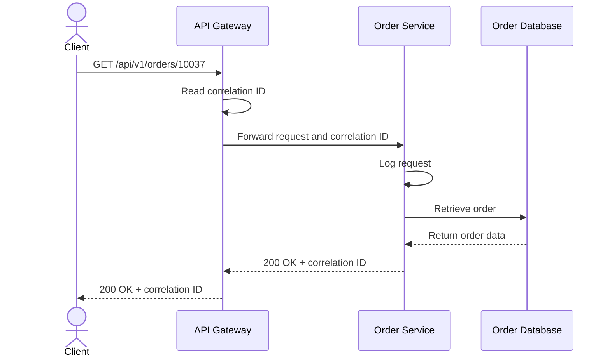
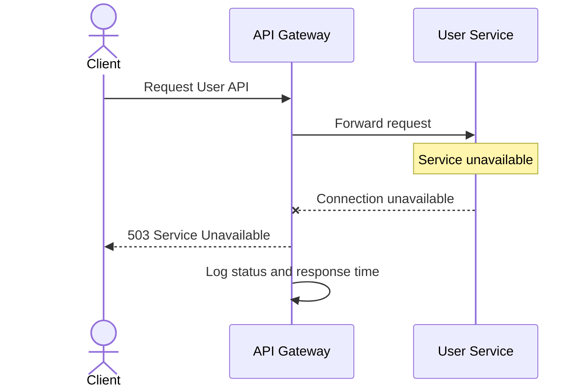
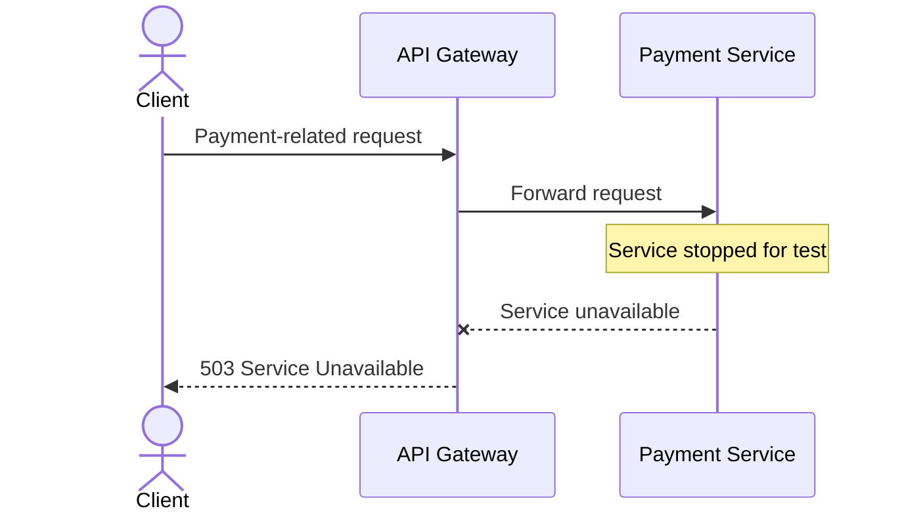
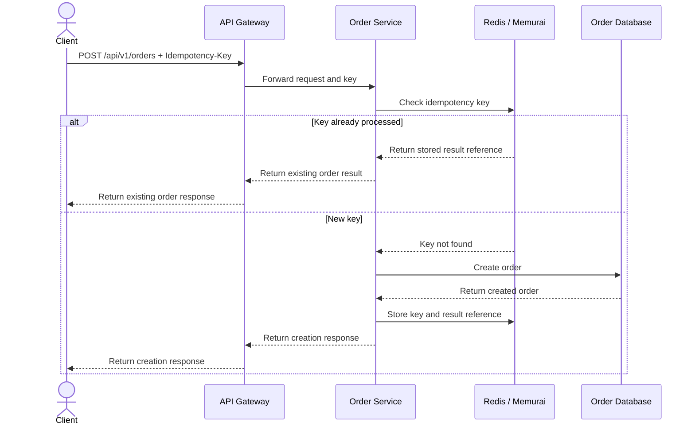
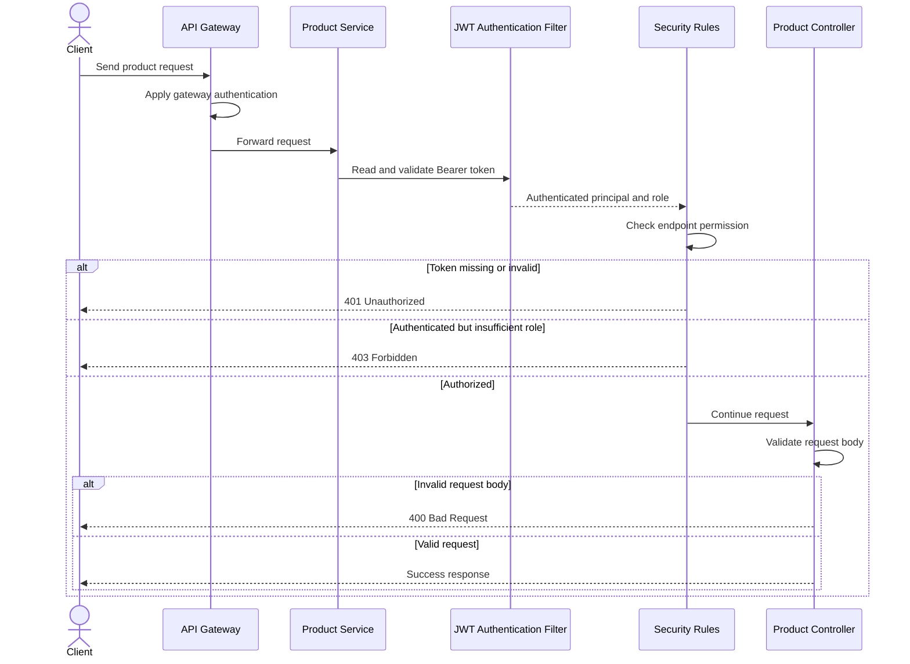

# JIRA Task 05 — Sequence Diagrams

## 1. Successful API Request

## 2. User Service Unavailable

## 3. Payment Service Unavailable

**Test note:** The User Service and Payment Service failure tests

## 4. Duplicate Request / Idempotency Flow

**Verification note:** This is a conceptual flow. Confirm the actual implementation, persistence behavior, and HTTP status codes against the Order Service before treating every step as verified.

## 5. Request Validation and Authorization

**Verification note:** This diagram describes the intended security and validation decision points. Confirm actual response behavior and error formatting with integration tests.
